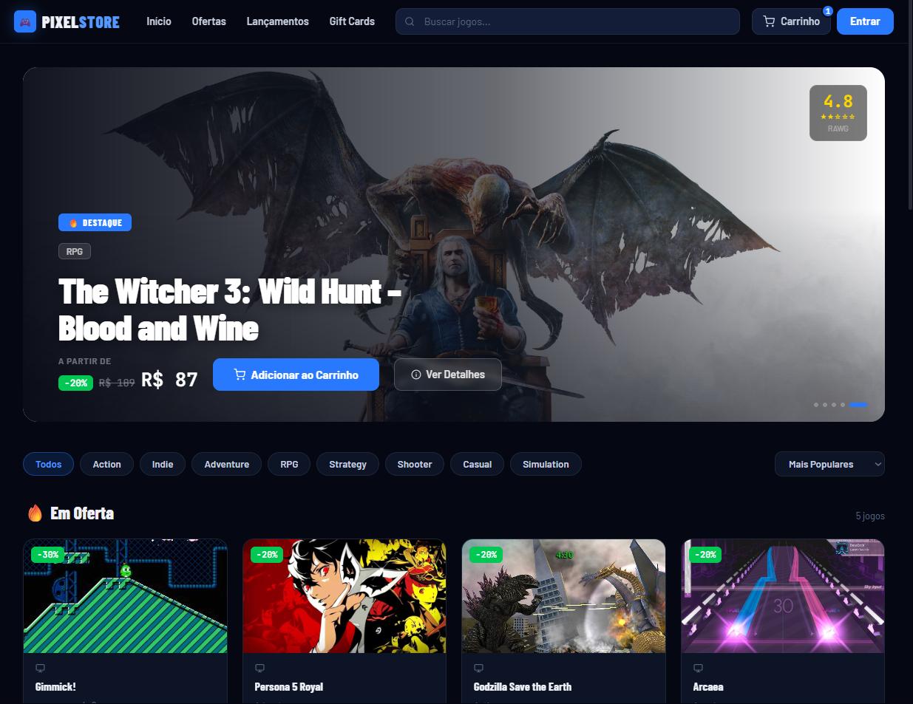
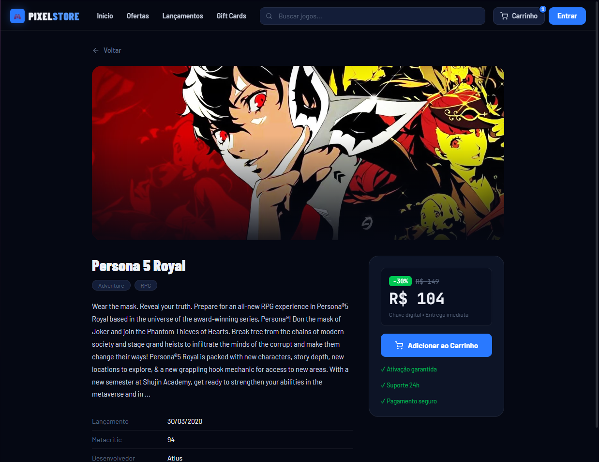
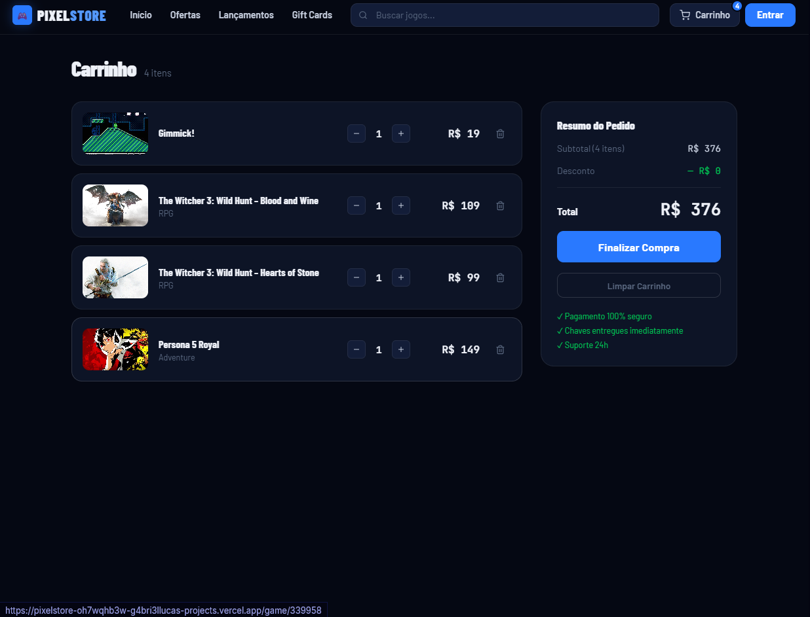

# 🎮 PixelStore

### E-commerce de games desenvolvido com React + TypeScript

[](https://react.dev)
[](https://typescriptlang.org)
[](https://vitejs.dev)
[](https://rawg.io/apidocs)

🔗 **Demo online:** [https://pixelstore-oh7wqhb3w-g4bri3llucas-projects.vercel.app]

---

## 📸 Screenshots

| Home | Detalhes do jogo | Carrinho |
| :---: | :---: | :---: |
|  |  |  |

---

## 📖 Sobre o Projeto

A **PixelStore** é um front-end de e-commerce de jogos digitais que consome dados reais da [API RAWG](https://rawg.io/apidocs). O projeto foi focado em praticar conceitos de React como gerenciamento de estado global, otimização de chamadas de API e uma interface responsiva com tema dark.

> **Nota:** a RAWG não fornece preços. Os preços e descontos exibidos são **simulados** por um algoritmo próprio, a partir dos metadados de cada jogo. O projeto não possui backend nem processa pagamentos.

---

## ✨ Funcionalidades

- 🎬 **Destaques dinâmicos:** slideshow automático com os 5 jogos principais da semana.
- 🔍 **Busca otimizada:** busca com *debounce* para reduzir requisições desnecessárias.
- 🏷️ **Filtros e ordenação:** navegação por gêneros e ordenação por preço, avaliação ou lançamento.
- 💰 **Lógica de preços:** geração de preços e descontos simulados a partir dos metadados da API.
- 🛒 **Carrinho persistente:** gerenciamento de itens com persistência via `localStorage`.
- 📄 **Páginas de detalhes:** requisitos do sistema, screenshots e descrição do jogo.
- 💀 **Experiência de uso:** *skeleton loaders* para evitar *layout shift* durante o carregamento.

---

## 🛠️ Tecnologias

- **Core:** React 19 e TypeScript 5
- **Build e qualidade:** Vite, ESLint
- **Navegação:** React Router DOM 7
- **Estilização:** CSS Modules e CSS global
- **API:** Axios e RAWG Database
- **Estado:** React Context API
- **Testes (em configuração):** Vitest e Testing Library

---

## 📁 Estrutura de Pastas

```
src/
├── components/   # Componentes reutilizáveis (Navbar, Sidebar, Banner)
├── context/      # Gerenciamento de estado do carrinho
├── pages/        # Páginas da aplicação (Home, Cart, GameDetail)
├── services/     # Configuração do Axios e helpers da API
├── tests/        # Configuração do ambiente de testes
└── assets/       # Estilos globais e recursos estáticos
```

---

## 🚀 Como executar o projeto

1. Clone o repositório:

```bash
git clone https://github.com/g4bri3llucas/PixelStore.git
cd PixelStore
```

2. Instale as dependências:

```bash
npm install
```

3. Configure a chave da API. Crie uma chave gratuita em [rawg.io/apidocs](https://rawg.io/apidocs), copie o arquivo de exemplo e preencha:

```bash
cp .env.example .env
```

Depois edite o `.env`:

```
VITE_API_KEY=sua_chave_aqui
```

4. Inicie o servidor de desenvolvimento:

```bash
npm run dev
```

---

## 🗺️ Roadmap

- [ ] Autenticação de usuário
- [ ] Wishlist (lista de desejos)
- [ ] Checkout simulado
- [ ] Finalizar a migração total para TypeScript
- [ ] Testes unitários com Vitest (ambiente já configurado)

---

## 👤 Autor

Desenvolvido por **Gabriel Lucas** · [GitHub](https://github.com/g4bri3llucas)

Dados de jogos fornecidos pela [RAWG](https://rawg.io).